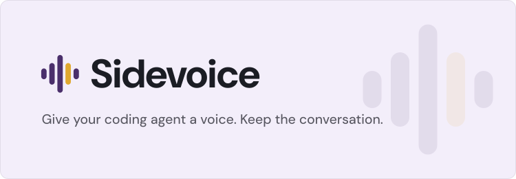

<!-- Header: .github/assets/readme-header*.svg, from the Sidevoice brand's banner. Badges: shieldcn
     (https://shieldcn.dev), each a light/dark pair so the row follows the reader's GitHub theme. -->
<picture>
  <source media="(prefers-color-scheme: dark)" srcset=".github/assets/readme-header-on-dark.svg" />
  
</picture>

<p>
  <a href="https://github.com/sidevoice/sidevoice-core/actions/workflows/release.yml"><picture><source media="(prefers-color-scheme: dark)" srcset="https://shieldcn.dev/github/ci/sidevoice/sidevoice-core.svg?variant=secondary&size=sm&workflow=release.yml&branch=main&mode=dark" /></picture></a>
  <a href="LICENSE"><picture><source media="(prefers-color-scheme: dark)" srcset="https://shieldcn.dev/github/license/sidevoice/sidevoice-core.svg?variant=secondary&size=sm&mode=dark" /></picture></a>
  <picture><source media="(prefers-color-scheme: dark)" srcset="https://shieldcn.dev/badge/status-beta.svg?variant=secondary&size=sm&mode=dark" /></picture>
</p>

# sidevoice-core

Reading your coding agent's plans, diffs and summaries all day is tiring. **Sidevoice** turns the conversation you
already have with your agent into a voice call. The agent keeps its context and keeps writing as usual; it also
speaks its replies, and you answer by voice and can interrupt it — from the sofa or on a walk, not only at your desk.

**sidevoice-core** is the part that runs on the machine where your agents run. It keeps that machine's
conversations, carries them between your devices and your agents as text and events, and decides which of your
devices may use it. The voice itself (listening, turns, transcription, speech) runs on your device, in
[sidevoice-voice](https://github.com/sidevoice/sidevoice-voice).

## How it fits

| Piece | Role |
|---|---|
| [sidevoice-connector](https://github.com/sidevoice/sidevoice-connector) | What you install on that machine. It gives your agents their voice tools and installs, starts and supervises this core. |
| **sidevoice-core** (this repository) | The conversations, next to the agents. |
| [sidevoice-desktop](https://github.com/sidevoice/sidevoice-desktop) | The app you call from. |
| [sidevoice-web](https://github.com/sidevoice/sidevoice-web) | The call interface the app bundles; it can also be served as a static site. |

Your **machine** is the computer where your coding agents run; a **device** is what you call from (the desktop
app, a browser). A device talks to the core directly once it is paired with it. You do not normally install the core yourself: the
connector installs the version it was released with.

## Status

Beta. What works today:

- Voice calls with your agent's conversation from paired devices: your device turns what you say into text, which
  reaches the conversation as a message, and speaks the agent's replies, which the core sends as text.
- What you did not hear is never played late: your device reports how far each reply was heard, and the agent is
  told what you missed.
- Several devices in the same conversation.
- One-time pairing codes, per-device tokens and immediate revocation.

To reach your machine from outside your network, serve it at a URL you control (a reverse proxy, say) and list that URL in `SIDEVOICE_PUBLIC_URLS`, so the pairing code carries it.

## Build it from source

Rust 1.98 and a C compiler:

```sh
cargo test --locked --all-features
cargo run --locked --release        # listens on 127.0.0.1:10829
```

`--help` lists its options. The connector starts it as `sidevoice-core-rust --data-dir D --port P`; `D/core.json`
(mode 0600) then says where it listens and which credential the connector links with. Its local channel, `endpoint`
there, is a Unix socket on macOS and Linux and a named pipe on Windows, and serves only processes of the same user;
`POST /api/local/shutdown` on it stops the core as `SIGTERM` does on Unix. On Windows another process asks the core to
leave by setting its named event `Local\sidevoice-stop-<pid>` (`sidevoice-platform`'s `stop`). `cargo xtask dist` builds,
packages and verifies this machine's release archive, exactly as a release does ([`RELEASING.md`](RELEASING.md)).

Compatibility with the latest published connector and web client is `cargo xtask compat`, run weekly in CI.

The conversation epoch, speech admission, playback fate and common push/pull notice contract is in
[`docs/conversation-flow.md`](docs/conversation-flow.md).

## Configuration

Its data — paired devices, the machine's identity key, the conversation journal — lives in
`SIDEVOICE_CORE_DATA_DIR`, else `~/.sidevoice/core`. Every secret file there is created with mode 0600.

| Variable | What it does |
|---|---|
| `SIDEVOICE_PUBLIC_URLS` | Comma-separated additional addresses where devices can reach this machine directly; they go into pairing codes. Each must be `https://` (see Security). When bound to a network interface, the Core also includes its private IP addresses and actual port for native LAN pairing. |
| `SIDEVOICE_TRUSTED_CLUSTER_HOSTS` | Hosts that may receive credentials over plain HTTP. Empty by default (see Security). |
| `SIDEVOICE_ALLOWED_HOSTS`, `SIDEVOICE_ALLOWED_ORIGINS` | Without an explicit Host list, numeric IP addresses are accepted in `Host` for direct network access; DNS names still need an allowed Host or Origin. Setting `SIDEVOICE_ALLOWED_HOSTS` disables automatic numeric-IP acceptance, including when set to an empty value. Allowed Origins also grant their own Host names. |
| `SIDEVOICE_CORE_HOST`, `SIDEVOICE_CORE_PORT` | Where to listen (default `127.0.0.1:10829`). |

The Connector binds the Core to all IPv4 interfaces by default. Its pairing code lists up to seven private IP
addresses on active interfaces (or the explicitly bound private IP), with the actual listening port. The desktop app
can use one of these for direct LAN pairing after the person's private HTTP consent. A configured
`SIDEVOICE_ALLOWED_HOSTS` still restricts the advertised addresses to those its Host policy accepts. The list is a
local hint, not a proof that another device can route to an address; firewall, network and browser policy still
apply. The Core's standalone bind default remains loopback.

## Security

- **Devices.** Every route except discovery, the identity proof and redeeming a pairing code needs a device token.
  A device gets one by redeeming a one-time code (valid ten minutes); the core keeps only its hash, and revoking a
  device ends its open calls at once. Every paired device has the machine's full authority: there are no roles.
- **Discovery** (`GET /api/rendezvous`, `GET /api/device/identity`) answers without a token and says only what
  pairing needs: that this is a Sidevoice machine, its fingerprint and public key, and a signature over the
  caller's nonce. The machine's name is given only to a paired device.
- **Network limits.** In each 60-second window the TCP listener allows 10 failed pairing attempts per peer IP and
  40 globally, or 60 failed authentication attempts per peer IP and 300 globally. Further attempts receive 429
  with `Retry-After`. It serves at most 256 concurrent HTTP or WebSocket connections. The peer is the direct TCP
  address (the proxy's address behind a proxy); forwarded headers are ignored. The local channel has no such limits.
- **Transport.** The core serves plain HTTP on its listen address. The web client normally sends pairing secrets
  and device tokens only over HTTPS or loopback; the native app can also send them to a private LAN address after
  explicit unencrypted-connection consent. Anyone able to read that LAN traffic can read those credentials. Public
  access needs a trusted HTTPS/WSS endpoint. Core-advertised URLs and connector credentials use HTTPS, loopback,
  or hosts in `SIDEVOICE_TRUSTED_CLUSTER_HOSTS`. An entry starting with a dot is a suffix
  (`.svc.cluster.local`); any other entry is one exact host. Listing a host there states that the network to it is
  yours (a Kubernetes cluster's pod network, say): whoever can read that network can read those credentials.
- **Proxies are trusted.** A reverse proxy between a device and this machine terminates TLS on both sides: it sees the pairing
  secret redeemed through it, device tokens and all the traffic, including what you say as text and the agent's
  replies. The machine's signed identity proves which machine answered; it encrypts nothing. Use only a proxy you
  trust, or reach the machine directly. End-to-end encryption to the machine's pinned identity is planned, not
  there yet.

Please report vulnerabilities privately through
[GitHub's security advisories](https://github.com/sidevoice/sidevoice-core/security/advisories/new), not in an issue.

## Layout

```
rust/              the core: one crate, the binary sidevoice-core-rust
  runtime/         process configuration, launch handshake, listeners, shutdown
  server/          the device and connector surfaces (HTTP, WebSocket, Socket.IO) and the calls they carry
  control/         conversations, devices and pairing, latency, telemetry
  messages/        the message bundles: English only, one file per language
  storage/         private files and process locks
  platform/        the OS door: re-exports the shared crate below, plus the core-only concerns (signals)
platform/          sidevoice-platform: OS code shared with the connector (this user, the local channel)
tests/             integration tests
xtask/             build tooling: release archives, manifest, compatibility (`cargo xtask`)
```

## Contributing

Issues and pull requests are welcome. Read [`AGENTS.md`](AGENTS.md) first: it holds the rules for code, texts and
tests, for people and coding agents alike. Pull request titles follow
[Conventional Commits](https://www.conventionalcommits.org) (CI checks them) and become the squashed commit, from
which release notes are written ([`RELEASING.md`](RELEASING.md)).

## Licence

[Apache-2.0](LICENSE). The Sidevoice name and logo are trademarks: forks are welcome under their own name — see
[`TRADEMARKS.md`](TRADEMARKS.md).
